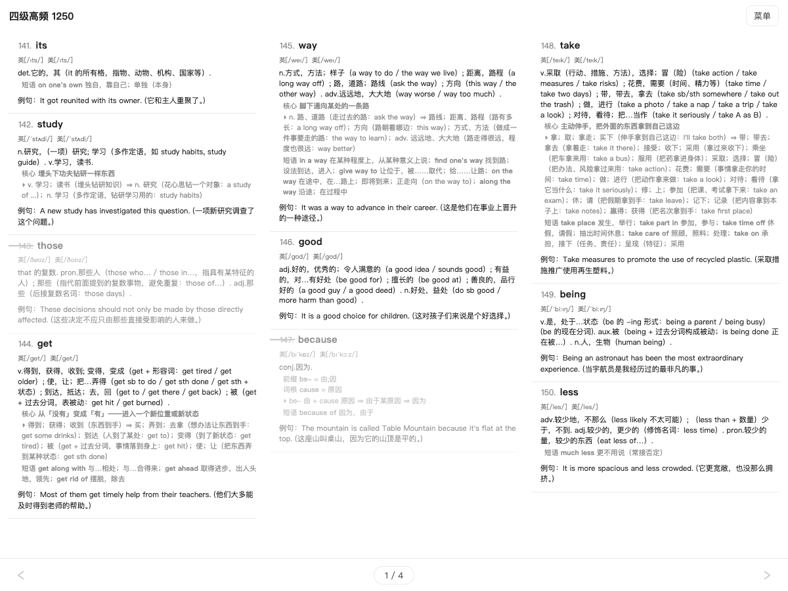
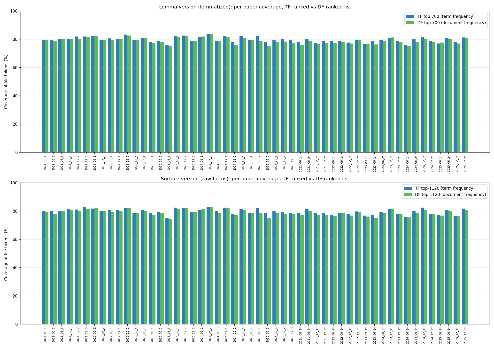

# [CET4]2026英语四级高频词汇免费（近五年）可打印PDF1250词，大学生核心

从近五年（2021–2025）大学英语四级（CET-4）**真题**中统计出 1250 个高频词，排成可以打印背诵的词表，免费使用。
本项目复现并改进了 [liut969/CET](https://github.com/liut969/CET) 的思路。

## 下载 PDF

| 文件 | 适合谁 | 内容 |
|------|------|------|
| [**彩色背诵版**](<英语四级高频单词彩色背诵版.pdf>) | 从零开始背 | 音标、真题释义、核心意象 / 词根词缀、真题短语、真题例句；词头带音节划分。93 页 |
| [**黑白背诵版**](<英语四级高频单词黑白背诵版.pdf>) | 同上，黑白打印 | 和彩色版内容相同，全黑排版 |
| [**查缺补漏版**](<英语四级高频单词查缺补漏版.pdf>) | 已经背过一轮 | 只留单词、全部真题义项和真题短语，三栏排版，18 页扫完。熟词的生僻意思（take 的「修课程」「服用」）也在里面 |

## 这份词表好在哪

它是为**从零开始自学、目标是考过四级**的人做的，不是词典：只教真题里会碰到的东西，背了就能在真题里认出来。
义项标注、核心意象、词根拆解都由 Claude 完成，原则是**准确优先**——拿不准的宁可不写，也不硬编。

- **词是从真题里数出来的**：统计 2021–2025 年全部四级真题（含听力原文），按「在多少份卷子里出现过」排序，取前 1250 个。
- **只讲真题里用到的意思**：Claude 把这 1250 个词在真题里出现的 **93,091 处句子逐句读过**，标出每一处用的是哪个意思，
  只保留真题里真出现过的义项，按出现次数排序，最核心的意思排第一。答题说明里的套话不计数。
  比如 bank 词典里有「河岸」「倾斜飞行」，真题里没出现，就不列；scale 只剩「规模；等级，量表」，没有「鳞片」「天平」。
- **例句是真题原句**：第一个义项的例句从真题里挑，附中文翻译。
- **真题常见短语**：在真题里出现 3 次以上的固定搭配单独列出（每词最多 5 条，273 个词有），比如 take 下面的 take place、take part in、take care of。
- **多义小词用一个画面串起来**：take、get、over 这类短词拆不出词根，义项又多，就给一个「核心意象」——
  take 是「主动伸手，把外面的东西拿到自己这边」，由此推出 乘坐（把车拿来用：take a bus）、服用（把药拿进身体）、花费（事情拿走你的时间：take time）……
  串不起来的义项写「单独记」，不硬凑。共 **208 个词**有。
- **长词拆词根**：可拆的词给出前缀、词根、后缀和推导（instead = in- 在… + stead 位置 ⇒ 处在别人的位置上 ⇒ 代替），
  拆不出的不强拆。共 **523 个词**有。

## 背单词网页

同一份词表也做成了网页，手机、iPad、电脑打开就能背，能发音、划掉已掌握的词、自测，还能装到主屏幕离线用：

👉 **[yiyisheh.github.io/CET4-vocabulary](https://yiyisheh.github.io/CET4-vocabulary/)**　·　[功能和用法说明](背单词网页.md)



## 前言

市面上的"四级高频词"良莠不齐，无从判断是否真高频、背了是否有用。
liut969 的方法很可信：直接统计历年真题里每个词的出现频次，按频率排序
本项目用**更新的 2021–2025 真题**重做一遍，并在方法上做了三点改进：

1. **词形还原**：把 `studies / studied / studying` 合并计入 `study`（liut969 是按词形原样计数）。
   两种口径都产出，见 `output/`。
2. **文档频率（DF）**：除了累计词频（TF），还统计"一个词出现在多少套卷子里（DF）"，
   衡量跨卷稳定性。
3. **真实例句**：每个词的例句直接取自真题原句。

如果能帮助到大家最好不过。
理论来说应该可以简单的复刻CET6和考研英语。
如果有人制作了CET6和考研英语版本或者国内下载链可以联系我放上来。

## 结论

| TF版本指标      | 词形还原版       | 词形原样版        |
| ----------- | ----------- | ------------ |
| 总词数（unique） | 6,837       | 9,398        |
| 总 token     | 145,621     | 144,749      |
| 80% 累计覆盖截点  | top-**701** | top-**1124** |

- **逐卷覆盖率**：全局 80% 高频表在每一份单卷中同样覆盖约 **80%** 的词次
  （`coverage_chart.png`）——证明高频词是真高频，方法成立。
- **TF vs DF**：两种口径产出的榜单 top-N 重叠约 **88%**，逐卷覆盖率仅差 0.8 个百分点
  （`coverage_tf_vs_df.png`）——榜单对计数方式稳健。
- **与 liut969 对比**：词形原样版 top-1250 与其 2018–2023 词表重叠 **76.8%**；
  差异主要来自话题更替，正是用新数据重做的意义。

---

> 有意思的是，DF 和 TF 几乎一样：


|对比项|词形还原版|词形原样版|
|---|---|---|
|DF 榜 vs TF 榜 top-N 重叠|87.9%|88.6%|
|逐卷覆盖率（TF 榜）|79.7%|79.7%|
|逐卷覆盖率（DF 榜）|78.9%|78.9%|

- 改成"每卷只算一次"对高频榜单**几乎没影响**——两种榜单 ~88% 相同，覆盖率只差 0.8 个百分点。这其实是**稳健性验证**：真高频词既"出现次数多"又"每套卷都出现"，两个指标自然一致。
- DF 榜覆盖率略低（-0.8pp）符合预期：TF 排序天然就是为"覆盖最多 token"优化的；DF 排序优化的是"分布广度"，会让个别"每卷都出现但单卷次数不多"的词挤掉高 TF 词。
- 真正的差异只在**中长尾**——比如某篇阅读反复出现的话题词（高 TF、低 DF）会在 DF 榜里降级。



## 方法

```
真题 PDF ─→ corpus/ 纯英文语料（试卷 + 听力原文）
              │
              ├─ build_frequency.py / build_doc_frequency.py ─→ output/ 词频表（TF / DF）
              │
              └─ 义项标注（Claude 逐句标注）─→ intermediate/senses.json 真题义项、例句、短语
                                               │
  intermediate/roots.json 词根 ────────────────┤
  intermediate/core.json  核心意象 ────────────┤
                                               ▼
                         build_dataset.py ─→ intermediate/entries_full.json（1250 词最终数据）
                                               │
                                               ├─ make_pdf_optimized.py ─→ 三份 PDF
                                               └─ build_html.py ─→ 背单词网页（docs/）
```

- **语料**：真题试卷和听力原文转成纯英文文本，放在 `corpus/`。
- **统计**：spaCy 分词 + 词形还原；保留功能词（不过滤停用词，与 liut969 一致）。
- **统计窗口**：参与统计的年份只在 `corpus/window.json` 里配置，以后加入新一年的真题只改这里。
- 义项、核心意象、词根的生成细节和网页的构建见 [WEB_HANDOFF.md](WEB_HANDOFF.md)。

## `output/` 说明

| 文件 | 内容 |
|------|------|
| `high_freq_surface.csv` | 词频表 · 词形原样版（liut969 口径，9393 词） |
| `high_freq_lemma.csv` | 词频表 · 词形还原版（6835 词） |
| `high_freq_surface_df.csv` / `high_freq_lemma_df.csv` | 文档频率（DF）表 |
| `high_freq_cet4_df.txt` | 按文档频率排序的 1250 词词表（序号、音标等基础信息） |
| `coverage_chart.png` · `coverage_tf_vs_df.png` | 方法验证图表 |

## 目录结构

```
.
├── 英语四级高频单词*.pdf     三份成品 PDF
├── README.md                本文
├── 背单词网页.md             网页的功能和用法
├── WEB_HANDOFF.md           开发文档（网页、数据流水线）
├── CET/cet4_2021 … 2025/    源数据：四级真题 PDF（及听力 MP3）
├── corpus/                  纯英文语料（papers/ + listening/）+ 统计窗口 window.json
├── output/                  词频表与验证图表
├── intermediate/            处理好的数据：真题义项、词根、核心意象、发音，以及 1250 词最终数据
├── synbook/                 同义词辨析书：分组数据 + 207 组正文
├── scripts/                 统计、数据合并、PDF 与网页构建脚本
├── web/                     背单词网页源码
├── docs/                    网页的 GitHub Pages 托管目录（构建产物）
└── images/                  README 截图
```

## 复现

仓库里已经包含语料和处理好的数据，不需要任何 API key：

```bash
# 1. 环境
python -m venv .venv && source .venv/bin/activate
pip install -r requirements.txt
python -m spacy download en_core_web_sm

# 2. 词频统计与验证图表
python scripts/build_frequency.py      # 词频表 TF
python scripts/build_doc_frequency.py  # 文档频率表 DF
python scripts/per_paper_coverage.py   # 逐卷覆盖率图
python scripts/coverage_compare.py     # TF vs DF 对比图

# 3. 合并数据，生成 PDF 和网页
python scripts/build_dataset.py        # → intermediate/entries_full.json
python scripts/make_pdf_optimized.py   # → 三份 PDF
python scripts/build_synbook.py        # → 同义词辨析书（要在 build_html 之前）
python scripts/build_html.py           # → docs/ 网页
```

> PDF 字体用 `/Library/Fonts/Arial Unicode.ttf`（macOS）；其他平台请改
> `scripts/make_pdf_optimized.py` 里的 `FONT_PATH` 为本机一个含中文与音标的字体。

## 致谢

- 方法与参考词表：[liut969/CET](https://github.com/liut969/CET)

> 真题 PDF 等源数据版权归命题方所有，仅供学习研究使用。