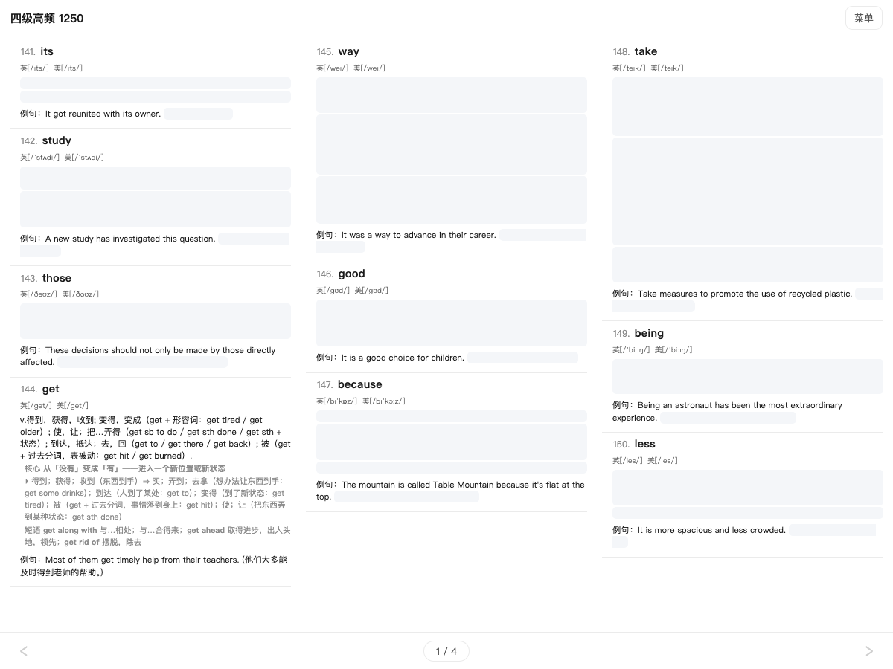

# 背单词网页

👉 **[yiyisheh.github.io/CET4-vocabulary](https://yiyisheh.github.io/CET4-vocabulary/)**

四级高频 1250 词的背单词网页。手机、iPad、电脑的浏览器都能直接打开，不用注册、不用下载 App。
内容和 [彩色背诵版 PDF](<英语四级高频单词彩色背诵版.pdf>) 一样（词表怎么做的见 [README](README.md#这份词表好在哪)），排版也照着 PDF 来，屏幕宽时自动分成多栏。

## 一个词条里有什么

从上到下依次是：

1. **序号和单词**
2. **音标**（英 / 美）
3. **释义**：只列真题里出现过的意思，最核心的排第一
4. **核心意象** 或 **词根词缀**（灰色小字）：多义小词给一个画面串起各个意思；长词拆成前缀、词根、后缀
5. **短语**：真题里出现 3 次以上的固定搭配
6. **例句**：真题原句，附中文翻译

## 怎么用

| 操作 | 效果 |
|---|---|
| 点单词 | 念美音，同时显示音节划分（`com·po·si·tion`），再点一次切回来 |
| 点例句 | 朗读整句 |
| 点序号或左侧空白 | 划掉这个词，表示已经记住（变灰 + 划线）；再点一次取消 |
| 点词条其他地方 | 念这个词 |
| 点底栏两边 `‹` `›` 或左右滑动 | 翻页 |
| 点底栏中间的页码 | 弹出滑块，拖动快速跳页 |
| 点右上角「菜单」 | 回主菜单 |

主菜单有两个按钮：

- **开始背诵**：回到上次背到的地方，内容不变。
- **重置**：重新生成这一轮要背的词（去掉已划掉的、推进状态池、重新打乱、自测重新遮住）。**只有点它，页面上的词才会变**，平时划词、切后台都不会让页面跳动。

## 推荐的背法

**自测**（设置 → 自测）：释义、核心意象 / 词根、例句翻译都被浅灰色块遮住，只露出单词和英文例句。先自己想意思，再点灰块看答案。

**状态池**（设置 → 状态池模式）：不想面对 1250 个词的长列表时打开它。每次只背一小批（默认 40 个）还没划掉的词；划掉的够多了（剩 15 个以下），回主菜单点「重置」，下一批新词就补进来。还可以打开「池内乱序」，避免按顺序背形成位置记忆。池大小和推进阈值都能改。

## 装到主屏幕，离线使用

- **iPhone / iPad**：用 Safari 打开网址，点「分享 → 添加到主屏幕」。之后从主屏幕图标打开，全屏显示，像 App 一样。
- **安卓 / 电脑**：Chrome 地址栏或菜单里选「安装应用」/「添加到主屏幕」。

第一次打开时，网页会在后台下载约 36 MB 的单词和例句发音。下载期间已经可以背，单词发音暂时走网络；下完之后断网也能用。进度在「设置 → 离线缓存」里看。

网页有新版时会弹窗问你要不要更新，不会自己突然刷新；也可以在「设置」底部的版本号一行点「检查更新」。更新只重新下载几百 KB 的页面，发音不用重下。

## 多端同步

手机和 iPad 都在用？在「设置 → 多端同步」里给每台设备填**同一个同步码**（自己编一个不容易撞的，比如 `cet4-9f3k`），划掉的词就会在设备之间同步。只同步划线和自定义颜色，其他设置各台设备分开。

## 其他

- **同义词辨析 · 207 组**：主菜单里的入口。把 1250 词里意思相近、容易混的词分成组，逐组讲清区别。
- **可调的显示**：字号、栏数、间距、背景色、主题色、划线样式、分界线、左右翻页 / 上下滚动、是否显示例句、每隔多少词标一次累计数。
- **发音**：单词是美音，例句是两位男声随机朗读。觉得开头有空白或太急，可以在设置里调「跳过开头静音」和「例句播放前延迟」。

---

想改网页或自己构建，请看 [WEB_HANDOFF.md](WEB_HANDOFF.md)（开发交接文档）。
